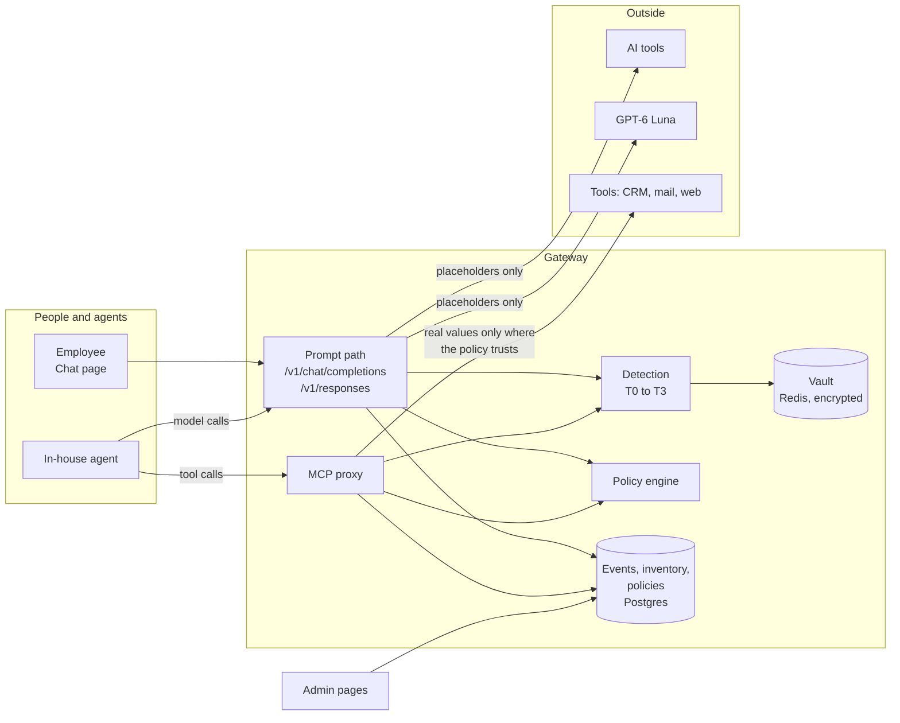

# Architecture

One gateway does all the inspection. Everything else either sends traffic through it or
reads what it recorded.

## Services

| Service | Tech | Role |
| --- | --- | --- |
| `gateway` | FastAPI | OpenAI-compatible proxy with streaming, MCP proxy, detection, vault, policy, event logging, admin APIs |
| `web` | React, served by nginx | All pages; nginx also forwards `/api`, `/v1` and `/agent-api` |
| `postgres` | Official image | Events, inventory, policies, protected terms, custom patterns, fingerprint vectors |
| `redis` | Official image, persistence off | The vault, and the reload signal between workers |
| `agent` | FastAPI | Demo helpdesk agent. Reaches the model and every tool only through the gateway |
| `mcp-crm`, `mcp-mail`, `mcp-web` | MCP Python SDK | Mock tools. Mail keeps what was sent to outside addresses; web serves the poisoned page |
| `mock-upstream` | FastAPI | Stand-ins for public AI tools. Records exactly what it received |
| `seeder` | One-shot job | Loads the demo organisation through the gateway's own APIs |

The stack needs `OPENAI_API_KEY` and does not start without it. The tests call no model:
doubles in the test directories stand in for OpenAI, and nothing of them is in the product
code.

## The prompt path

Every request takes the same route (`gateway/app/proxy`):

1. **Identify** the caller from the session token and the destination AI tool from the
   `X-Aspida-Tool` header, and look the tool up in the inventory.
2. **Collect every text the model would read**: message content, instructions, tool
   results, past function-call arguments and the descriptions in tool definitions. A field,
   item type or content part the gateway cannot inspect is refused with a 400 that names
   it; images and files pass only to an approved tool.
3. **Detect locally.** Normalise and decode each text, then run tiers T0 and T1. Nothing
   leaves the gateway in this step.
4. **Mask.** The vault replaces each finding with a placeholder such as `<PERSON_1>`. The
   same entity keeps the same placeholder for the whole conversation, whatever form it is
   mentioned in.
5. **Look at the masked text.** Tier T2 compares it with fingerprints of protected
   documents and with category exemplars; tier T3 asks GPT-6 Luna only when the earlier
   tiers are inconclusive.
6. **Decide.** The policy engine returns the first matching rule's action, with an
   explanation: what was found, which rule fired, what was done, what to do instead.
7. **Act.** Allow forwards unchanged. Redact forwards the masked text. Warn answers 409
   with the findings, and sends the masked text once the user confirms. Block answers 403
   and suggests an approved tool.
8. **Restore.** The response streams back through the rehydrator, which swaps placeholders
   for real values even when a placeholder is split across chunks.
9. **Record** one event: kinds of data and counts, tool, team, action, rule, timings and
   cost. Never the text.

### Detection tiers

| Tier | Method | Finds | Runs |
| --- | --- | --- | --- |
| T0 | Patterns with checksum validators, entropy checks, custom patterns (RE2) | AFM, AMKA, IBAN, cards, email, phone, ID numbers, API keys, tokens, private keys, connection strings, company identifiers | Always, locally |
| T1 | Presidio with spaCy for English and Greek, plus the protected terms list | People, organisations, locations, addresses, known client names | Always, locally |
| T2 | Embedding similarity against document fingerprints and category exemplars | Paraphrased or partial protected documents; text that resembles a contract, financial, health, HR or source-code document | On masked text |
| T3 | GPT-6 Luna, structured output, about 2 s timeout | Document-level category | On masked text, only when T0 to T2 are inconclusive |

The tiers match against three stores (`gateway/app/protected`): protected terms, document
fingerprints and custom patterns. Each is filled in layers: a **default pack** that ships
in the image and works for any company, optional **company data** (synced from a CRM or
uploaded), and the **demo organisation** loaded by the seeder. A change to a store, the
policy or the inventory is published on a reload bus and applies to the next request,
with no restart.

## The agent path

The agent's model never sees a real value, and tools receive real values only where the
policy trusts the destination.

- **Model calls** go to the gateway's `/v1/responses`, through the prompt path above.
  Assistant text is restored for the agent application; function-call arguments are left
  as the model wrote them, placeholders included.
- **Tool calls** go to the gateway's MCP proxy, which is an MCP server to the agent and an
  MCP client to the tool servers.
  - *Results coming in* are masked into the same conversation vault, checked for prompt
    injection, labelled trusted or untrusted by source, and wrapped as data. Untrusted
    content taints the session.
  - *Calls going out* are decided by the same policy file on the `tool_call` channel:
    a trusted destination gets real values, an untrusted one gets placeholders or is
    blocked, and a tainted session cannot cause side effects.
  - *What is trusted* is an admin's choice, per system, under Configure; it is stored in
    the settings table and applies from the next tool call. By default the CRM is trusted
    and the web and mail are not. Mail is judged when it delivers: a message carries real
    values only if every recipient is on a listed domain, which starts as the
    organisation's own.
- **Injection protection** has two layers and a canary. Layer 1 is heuristics in English
  and Greek; layer 2 is GPT-6 Luna. The policy setting `injection_protection` chooses how
  often layer 2 runs: `off`, `standard` (only to confirm what layer 1 flagged) or
  `detailed` (all untrusted content).

The vault is the first line of defence and detection the second: with protection switched
off, an agent that obeys an injected instruction can only send placeholders.

The demo agent asks for the model the gateway names, GPT-6 Luna by default. A real model
may ignore an injected instruction by itself; then there is no outgoing call to block,
and the flagged result and the tainted session are what the trace shows. The canary is a
tripwire, not a guarantee: it catches the system prompt leaking as written, reversed or
encoded, not a paraphrase.

## Policy

One YAML file governs people and agents (`policies/default.yaml`). Rules are ordered and
the first match wins; a rule matches on data types, tool status or a named tool, channel
(`prompt`, `tool_call`, `tool_result`), team, taint, side effects, and whether the source
or destination is trusted. Every saved policy is a version in Postgres; each event
records the version and rule that decided it, so a draft policy can be **replayed**
against past events without any raw text (`/api/policy/replay`; the web app has no screen
for it).

## Admin features

- **Monitor** reads three database views that carry no user column, and so do questions
  in plain language (`/api/ask`, which the web app has no screen for). A question is
  turned into one `SELECT`, which must pass a parser guard
  (`gateway/app/analyst/sql_guard.py`: one statement, the three views only, known
  functions only, a row limit) and then runs on its own database login, a role that can
  read those views and nothing else, in a read-only transaction with a five-second
  timeout.
- **Discovery** ingests proxy and DNS logs, updates usage per team, and queues unknown AI
  services for review with a drafted risk rating. It is reached through the API
  (`/api/tools`, `/api/discovery/queue`); the web app shows only the status of the tools on
  the Chat page.
- **Configure** is one page of settings: the status of each AI tool, how far the agent's
  systems are trusted, the protected data and the policy. A pattern can be added from a
  description: the model proposes an expression, and the gateway keeps it only if it
  compiles, finds a value in each of its own examples, and leaves its near misses and
  ordinary text alone
  (`gateway/app/protected/assist.py`).

## Privacy

See [privacy.md](privacy.md). In short: no raw text is stored anywhere, users are
pseudonymous and reporting is at team level. An admin can look up who sent one event, and
nothing records that lookup; a real deployment needs an audit trail and an approval step.

## Where things live

| Path | What |
| --- | --- |
| `gateway/app/core` | Shared types, protocols, sign-in, key handling, reload bus, text normalisation |
| `gateway/app/proxy` | The prompt path |
| `gateway/app/detect`, `gateway/app/protected` | Detection tiers and the stores behind them |
| `gateway/app/vault` | Placeholders, entity linking, encryption, rehydration |
| `gateway/app/policy`, `gateway/app/discovery` | Policy engine, inventory, log ingestion |
| `gateway/app/mcp_proxy` | MCP proxy, injection detection, taint |
| `gateway/app/analyst`, `gateway/app/privacy` | Dashboard and chat, privacy controls |
| `agent`, `mcp_servers`, `mock_upstream`, `seeder` | The demo's other containers |
| `defaults` | The default pack: terms, patterns, exemplars, AI tool catalogue |
| `eval` | Datasets, runner and committed results |
| `scripts` | `make smoke` (the employee and admin scenes), `make acceptance` (the rest of the brief), the sample log and the OpenAPI export |
| `contracts` | The OpenAPI contracts and the rules between modules |
