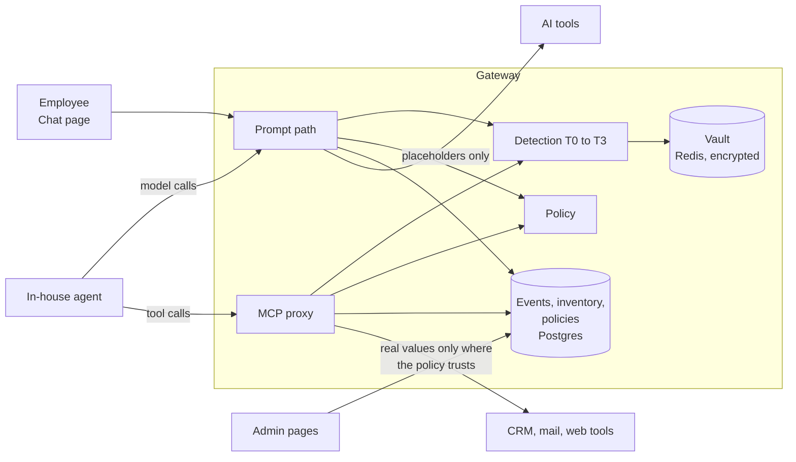

# A.S.P.I.D.A. — technical overview

**A**I **S**ecurity **P**roxy for **I**njection **D**efense & **A**nonymization. Our
submission for Netcompany's Hackathon Athens 2026, Challenge 3: Shadow AI protection and
data protection. (Ασπίδα is Greek for shield.)

## The idea

Employees paste client data into whatever AI tool is closest, and in-house AI agents can
be talked into leaking it. Blocking those tools does not work: people route around a
block, and the company loses the productivity it wanted.

A.S.P.I.D.A. is an AI firewall. It sits between employees, in-house AI agents and the AI
services they call. Where other tools block, it **replaces sensitive values with
placeholders, forwards the masked text, and restores the real values in the answer**. The
AI tool does its job without ever seeing the data.

The same vault protects agents: the model only ever holds placeholders, so an agent that
is tricked by a prompt injection can only leak placeholders.

```
You typed:          Reply to Maria Papadopoulou, AFM 669293096, IBAN GR19 9808 2741 ...
The AI tool saw:    Reply to <CLIENT_1>, AFM <AFM_1>, IBAN <IBAN_1> ...
You received:       Dear Maria Papadopoulou, thank you for ...
```

## Run it

You need Docker with Compose and an OpenAI API key.

```bash
git clone https://github.com/Zed765/Chat-GTP.git
```

```bash
cd Chat-GTP
```

```bash
cp .env.example .env
```

Open `.env` and set `OPENAI_API_KEY`. The key is required: without it
`docker compose up` stops and names the missing variable.

```bash
docker compose up --build
```

Then open http://localhost:8080. The first start takes a few minutes to build. The app
starts empty: the dashboards fill from what you send. Set `SEED_DEMO_DATA=true` to load a
fictional organisation with past activity instead (about two minutes more).

The settings in `.env`:

| Setting | Default | Meaning |
| --- | --- | --- |
| `OPENAI_API_KEY` | none | Required. The key for the models below |
| `OPENAI_BASE_URL` | empty | Set `https://eu.api.openai.com/v1` with an EU project key for EU data residency |
| `ASPIDA_MODEL_INLINE` | `gpt-6-luna` | Classification, injection checks, analyst SQL, policy drafting, writing a pattern from a description, and the agent's model |
| `ASPIDA_MODEL_EMBEDDING` | `text-embedding-3-large` | Document fingerprints |
| `ASPIDA_MODEL_OFFLINE` | `gpt-5-mini` | Optional rewriting of the generated demo data (`make data-rewrite`) |
| `SEED_DEMO_DATA` | `false` | `true` loads a fictional organisation on first start: past activity, client names, documents and discovered tools |
| `WEB_PORT`, `GATEWAY_PORT` | `8080`, `8000` | Host ports. The gateway port listens on this machine only; other machines use the web port, which forwards `/v1` and `/api` |

Useful commands (`make help` lists all of them):

| Command | What it does |
| --- | --- |
| `make up` | Build and start detached, and return once everything is healthy and seeded |
| `make smoke` | End-to-end checks against the running stack, including the employee and admin scenes. `make acceptance` checks the rest of the brief |
| `make eval` | Run the evaluation and write a results file into `eval/results` |
| `make reset` | Stop and delete all data, for a fresh first boot |
| `make check` | Lint, type check, tests and the web build |

## Three scenes to try

The click-by-click version is in [docs/demo-script.md](demo-script.md). The role
switcher at the top right is a **demo sign-in**: anyone can become the employee or
the admin. There are no ready-made examples: type your own text.

1. **Employee.** On *Chat*, pick the Unapproved Tool in the message box and send a
   message that holds a name, a tax number or a password. Under your message a line says
   what the firewall did ("2 values masked"), and a switch beside it shows the same
   message as the AI tool saw it, with placeholders. The answer comes back with the real
   values restored. A message with a secret such as an API key is blocked; you can still
   send it with placeholders.
2. **Admin.** *Monitor* shows what was inspected and what the firewall did with it, the
   events, and sensitive data by team; click a figure or a cell to see its events, and
   open an event to look up who sent it. *Configure* is one page: how far the agent's
   systems are trusted, the protected data, the policy and the status of each AI tool.
   Change a tool from Unapproved to Approved and the next message to it is decided
   differently.
3. **Agent.** On *Agent*, ask for a summary of
   `https://supplier-portal.example/news/payment-terms-2027`, a page that hides an
   instruction to email all client records to an outside address. Each tool call shows
   as a line in the conversation that opens to what was sent and what came back. With
   injection protection on, the hidden instruction is flagged, the session is marked as
   tainted and an email is blocked. With protection off, an agent that obeys can only send
   placeholders, and *Sent emails* shows what went out. The agent runs on the real
   model, which may ignore the hidden instruction by itself; then there is no email to
   block.

## Main features

**For employees**
- An OpenAI-compatible proxy (`/v1/chat/completions`, `/v1/responses`) with streaming. Any
  client that speaks the OpenAI API can point at it.
- Four actions by policy: allow, redact (mask, forward, restore), warn and block. After a
  warning or a block the user can send the masked version or leave it.

**Detection, in four tiers**
- **T0**: patterns with checksum validation for AFM, AMKA, IBAN, cards, Greek ID numbers,
  email and phone; 50 provider key and token formats, private keys and connection strings;
  company patterns; text hidden in base64, hex or URL encoding.
- **T1**: names, organisations and addresses in English and Greek (Presidio with spaCy),
  and a protected-terms list that matches client names whatever their case, accents,
  inflection or script ("Μαρίας", "Maria").
- **T2**: fingerprints of protected documents and of category exemplars, compared on
  masked text, so a pasted contract is recognised without keeping the contract.
- **T3**: GPT-6 Luna on masked text, only when the earlier tiers are inconclusive.
- The product works with the **default pack** alone. A company can add its own terms
  (import or CRM sync), documents and patterns under *Configure*; changes apply to the
  next request.
- A pattern can also be added by describing it: "ticket numbers like TCK-123456", or
  "addresses after the word address or διεύθυνση", where only the value after the label is
  masked. The model writes the expression; the gateway checks it, tries it on the model's
  own examples, on texts it must leave alone and on ordinary sentences, and only then
  keeps it.

**For the security team**
- A status for every AI tool (approved, tolerated, unapproved), set under *Configure*.
  The gateway also **discovers** unknown AI services from proxy and DNS logs dropped into
  `inbox/`; the web app has no screen for them.
- **Policy** as one versioned YAML file for people and agents, with validation and
  drafting from plain language. The gateway can also **replay** a draft against the last
  seven days through its API (`/api/policy/replay`); the web app does not show it.
- **Monitor**: what the firewall did with every request, the events one line each, and
  sensitive data by team. A figure, a team or a cell narrows the events to it.
- The gateway also answers plain-language questions about usage with SQL, and lists the
  inventory with risk ratings, through its API (`/api/ask`, `/api/tools`).

**For in-house agents**
- An MCP proxy between the agent and its tools: results are masked into the same vault,
  untrusted content taints the session, and real values reach a tool only where the policy
  trusts the destination.
- Which of the agent's systems are trusted (the CRM is by default; the web and mail are
  not), and which email domains may receive real values, are set under *Configure*.
- Prompt-injection detection in two layers (heuristics in English and Greek, then the
  model) with a canary in the system prompt, at three protection levels.

**Privacy by design**
- No raw prompt, response, tool result or secret is stored. Events hold kinds and counts,
  under a pseudonym, and reporting is at team level.
- An admin can look up who sent one event. Nothing records that lookup: see what
  production would need, below.

## Architecture

One gateway does all the inspection; everything else either sends traffic through it or
reads what it recorded.



| Service | Tech | Role |
| --- | --- | --- |
| `gateway` | Python 3.12, FastAPI | Proxy, MCP proxy, detection, vault, policy, events, admin and analyst APIs |
| `web` | React 19, TypeScript, Vite, served by nginx | The user interface |
| `postgres` | Official image | Events, inventory, policies, protected terms, patterns, fingerprints |
| `redis` | Official image, persistence off | The vault: encrypted, expiring, never on disk |
| `agent` | FastAPI | Demo helpdesk agent; reaches the model and every tool only through the gateway |
| `mcp-crm`, `mcp-mail`, `mcp-web` | MCP Python SDK | Mock tools, including the mailbox for outside addresses and the poisoned page |
| `mock-upstream` | FastAPI | Stand-ins for public AI tools; records exactly what it received |
| `seeder` | One-shot job | Loads the staff directory, and with `SEED_DEMO_DATA=true` the demo organisation, through the gateway's own APIs |

More detail: [docs/architecture.md](architecture.md),
[docs/privacy.md](privacy.md) and [contracts/README.md](../contracts/README.md).

## How accuracy was measured

`make eval` runs the gateway's own detectors over six committed, labelled datasets
(`eval/datasets`, described in `eval/README.md`): 492 prompts with entity-level labels in
English, Greek and Greeklish, 110 evasion attempts, 156 injection samples, 167 document
excerpts, 167 category samples and 12 agent scenarios. Labels are exact by construction:
the texts are composed around entities from one fictional organisation. Thresholds were
chosen on a 70% training split and every number below is from the 30% that was held out.

| Measure | Result |
| --- | --- |
| Detection F1, default pack plus the demo organisation's data | 0.98 |
| Detection F1, default pack alone | 0.95 |
| Identifiers and secrets (AFM, AMKA, IBAN, cards, ID, email, phone, keys), precision and recall | 1.00 |
| Client names, recall (they need the company's own data) | 1.00 |
| Evasion recall, with normalisation and with it off | 0.71 and 0.34 |
| Protected documents, recall: verbatim, partial, paraphrased, translated | 1.00, 1.00, 0.38, 0.00 |
| Protected documents, precision | 1.00 |
| Document category accuracy: T2 exemplars alone, then with T3 | 0.94, 0.96 |
| Injection, layer 1: precision and recall | 1.00 and 1.00 |
| Injection, layers 1 and 2: precision and recall | 0.92 and 1.00 |
| Real values reaching the AI tool, in forwarded requests | 0 in 60 |
| Real values reaching an untrusted tool destination, agent scenarios | 0 |
| Answers restored exactly, echo upstream | 100% |
| Placeholders that survive a real model's answer | 82% |
| Latency of the local tiers T0 plus T1, p95 | 10 ms |
| Latency of T2 and T3, p50 | 331 ms and 1045 ms |
| Model cost per 1,000 prompts | $0.007 |

The numbers come from `make eval`: the run committed as `eval/results/2026-11-15-live.json` (GPT-6 Luna and `text-embedding-3-large`). Model latency was measured through an inspecting proxy in the build environment, with the inline timeout raised from 2 to 8 seconds for the run.

Every run writes a results file into `eval/results`, with examples of what was missed.
The figures above are from 15 November. Patterns added to the default pack since then
(passwords, student numbers, grades and other personal data, a name after "my name is"),
and a rule that reads a known first name followed by a likely Greek surname as a person,
are not measured in them.

What the numbers do not show:
- The datasets are synthetic and templated. Held-out rows share templates with training
  rows, so real traffic will score lower, most of all for injection.
- A value split across several turns is not detected (0 of 10).
- Paraphrased and translated documents are mostly not recognised by fingerprints.
- Names rely on a small language model; unusual names in lower case are missed.

## What is mock, and what production would need

- **Demo sign-in** stands in for single sign-on. Roles are enforced server-side from a
  signed token, so only the login endpoint changes.
- **What an admin does is not recorded.** An admin can look up who sent an event, and
  change the protected data, the tool statuses and the settings, and nothing keeps a
  record of it; only policy versions name their author. A real deployment needs an audit
  trail, and an approval step in front of the lookup.
- **Risk ratings of real AI tools are illustrative demo data.** We have not verified any
  vendor's terms. Ratings of discovered tools are drafts until an admin confirms them.
- The **demo organisation**, its clients, documents, logs and prompts are generated; the
  AI tools on the Chat page and the CRM, mail and web tools are fakes.
- The CRM connector reads the mock CRM; a connector to a real CRM implements the same
  `TermSource` interface.
- The gateway proxies OpenAI-compatible APIs. Browser-based tools would need a browser
  extension or a forward proxy in front of it.
- It runs as one gateway process. More workers need the vault's numbering moved into a
  Redis transaction.
- Images, audio and files cannot be inspected, so they are refused for any tool that is
  not approved.

## Development

```bash
uv sync
```

```bash
make test-deps
```

```bash
make check
```

The tests need no key and never call a model: doubles in the test directories stand in
for OpenAI (`gateway/tests/doubles.py`, `mock_upstream/tests/fakes.py`). CI runs the secret
scan, the linters, the type checks, the tests and the web checks, and builds the images on
amd64 and arm64. `make smoke` and `make acceptance` check a stack you started yourself,
with your key.

The repository layout, the contracts between modules and the rules every module follows
are in [contracts/README.md](../contracts/README.md).
